  

<h1 align="center" style="color: #FFFFFF; font-family: 'Space Grotesk', sans-serif; letter-spacing: -0.02em; border-bottom: none; margin-top: 30px; margin-bottom: 10px;">LA3A Whitepaper</h1>

  
  
  

  <em style="color: #666666; font-family: 'JetBrains Mono', monospace; font-size: 13px;">Official Document — v1.0 · Author: @LARA · Published: Nov 14, 2026</em>

<h2 style="color: #FFFFFF; font-family: 'Space Grotesk', sans-serif; border-bottom: none; font-size: 24px;">01 — Abstract</h2>

LA3A is a Solana token built for blockchain gaming, with a hard cap of 100,000 tokens and a launch on September 19, 2030. It rests on one idea: <strong style="color: #FFFFFF;">players should truly own what they play and earn.</strong>

The ecosystem starts in 2029 with the official website and the Extension Game. The token follows one year later, on the project's first anniversary. This paper covers the vision, the technology, the token supply, the roadmap and the people building it.

Every 100 matches played in the game burn one LA3A token, up to a maximum of 25,000 burned in total, so the supply can only fall as the game grows.

<h2 style="color: #FFFFFF; font-family: 'Space Grotesk', sans-serif; border-bottom: none; font-size: 24px;">02 — At a glance</h2>

| Parameter | Detail |
| :--- | :--- |
| **Token** | LA3A on Solana |
| **Maximum Supply** | 100,000 LA3A |
| **Burn Rule** | 1 LA3A burned per 100 matches played |
| **Maximum Total Burn** | 25,000 LA3A |
| **Lowest Possible Supply** | 75,000 LA3A |
| **Website & Game** | September 19, 2029 |
| **Token Launch** | September 19, 2030, 00:00 UTC |
| **Official Channel** | Discord |

<h2 style="color: #FFFFFF; font-family: 'Space Grotesk', sans-serif; border-bottom: none; font-size: 24px;">03 — Introduction and vision</h2>

LA3A opens a new era of digital ownership for gamers: built for the future and powered by the next generation.

Our vision is a gaming world where the items, progress and value a player creates live on-chain and belong to that player. The token is the foundation, and the Extension Game is where it becomes something people can play.

The brand follows the same idea. Black and white, sharp lines, and a logo made of linked blocks: each block is a step in a chain, and the filled block at the end is the player.

<h2 style="color: #FFFFFF; font-family: 'Space Grotesk', sans-serif; border-bottom: none; font-size: 24px;">04 — The problem</h2>

In most games today, players spend time and money on items they do not actually own.

<ul style="color: #A0A0A0; line-height: 1.8;">
  <li><strong style="color: #FFFFFF;">Licensed, not owned.</strong> Items and progress sit inside one publisher's database and can be changed or removed at any time.</li>
  <li><strong style="color: #FFFFFF;">No way out.</strong> Value earned in a game usually cannot leave it, so effort cannot be carried to another place.</li>
  <li><strong style="color: #FFFFFF;">Slow and costly chains.</strong> Many blockchain games lose players to high fees and long waits for simple actions.</li>
  <li><strong style="color: #FFFFFF;">Unfair launches.</strong> Tokens that start with hidden allocations erode community trust before the game exists.</li>
</ul>

<h2 style="color: #FFFFFF; font-family: 'Space Grotesk', sans-serif; border-bottom: none; font-size: 24px;">05 — The LA3A solution</h2>

LA3A answers with two parts that work together: a capped token and a game built around it.

<ul style="color: #A0A0A0; line-height: 1.8;">
  <li><strong style="color: #FFFFFF;">The LA3A token.</strong> A fully decentralized token on Solana with a maximum supply of 100,000.</li>
  <li><strong style="color: #FFFFFF;">The Extension Game.</strong> A next-generation Web3 experience powered by LA3A, where players play, earn and truly own, all on-chain.</li>
</ul>

The launch is built on three commitments: <strong style="color: #FFFFFF;">fair distribution</strong>, <strong style="color: #FFFFFF;">locked liquidity</strong> and a <strong style="color: #FFFFFF;">community-first foundation</strong>.

<h2 style="color: #FFFFFF; font-family: 'Space Grotesk', sans-serif; border-bottom: none; font-size: 24px;">06 — Technology</h2>

LA3A is built on the Solana blockchain, chosen for its speed and very low transaction fees, which a game needs because players act constantly.

How to buy on launch day:

<ol style="color: #A0A0A0; line-height: 1.8;">
  <li>Create a wallet. Phantom and Solflare both work, in the browser or on mobile.</li>
  <li>Fund it with SOL, bought from any major exchange.</li>
  <li>Connect the wallet on the official swap page.</li>
  <li>Swap SOL for LA3A. The tokens appear in the wallet straight away.</li>
</ol>

<h2 style="color: #FFFFFF; font-family: 'Space Grotesk', sans-serif; border-bottom: none; font-size: 24px;">07 — Tokenomics</h2>

The supply is strictly capped at 100,000 LA3A tokens, which keeps the token scarce for the long term.

| Parameter | Detail |
| :--- | :--- |
| **Token** | LA3A |
| **Network** | Solana |
| **Maximum Supply** | 100,000 LA3A |
| **Burn Rule** | 1 LA3A burned for every 100 matches played |
| **Maximum Total Burn** | 25,000 LA3A |
| **Lowest Possible Supply** | 75,000 LA3A |
| **Token Launch** | September 19, 2030, 00:00 UTC |

<h2 style="color: #FFFFFF; font-family: 'Space Grotesk', sans-serif; border-bottom: none; font-size: 24px;">08 — Burn Mechanism</h2>

Every 100 matches played in the game burn one LA3A token, and the burning stops once 25,000 tokens have been burned in total. Burned tokens leave circulation for good.

| Rule | Value |
| :--- | :--- |
| **Trigger** | Every 100 matches played in the game |
| **Burn per trigger** | 1 LA3A |
| **Maximum total burn** | 25,000 LA3A |
| **Matches needed to reach the cap** | 2,500,000 |
| **Supply after the maximum burn** | 75,000 LA3A (25% below max supply) |

<h2 style="color: #FFFFFF; font-family: 'Space Grotesk', sans-serif; border-bottom: none; font-size: 24px;">09 — Roadmap</h2>

The website and the Extension Game arrive on <strong style="color: #FFFFFF;">September 19, 2029</strong>, and the token launches exactly one year later on <strong style="color: #FFFFFF;">September 19, 2030</strong>.

<ul style="color: #A0A0A0; line-height: 1.8;">
  <li>[ ] <strong style="color: #FFFFFF;">Phase 1: Foundation (2029)</strong> - Website & Game Release</li>
  <li>[ ] <strong style="color: #FFFFFF;">Phase 2: Evolution (2030)</strong> - Token Launch & Liquidity Lock</li>
  <li>[ ] <strong style="color: #FFFFFF;">Phase 3: Deflation (Ongoing)</strong> - Burn Mechanism Active</li>
  <li>[ ] <strong style="color: #FFFFFF;">Phase 4: Future (TBA)</strong> - CEX Listings & Expansions</li>
</ul>

<h2 style="color: #FFFFFF; font-family: 'Space Grotesk', sans-serif; border-bottom: none; font-size: 24px;">10 — Community and security</h2>

Discord is the only official LA3A channel for now. More channels will be added once they exist.

<ul style="color: #A0A0A0; line-height: 1.8;">
  <li>The official contract address will be published on the website and pinned in the Discord server exactly at launch.</li>
  <li>Do not trust a contract address from any other source.</li>
  <li>Never share your wallet's seed phrase or private key with anyone, for any reason.</li>
</ul>

<h2 style="color: #FFFFFF; font-family: 'Space Grotesk', sans-serif; border-bottom: none; font-size: 24px;">11 — FAQ</h2>

When does LA3A launch?

 
The website and the Extension Game arrive on September 19, 2029. The token launches on September 19, 2030 at 00:00 UTC.

Which blockchain is it on?

 
Solana.

What is the maximum supply?

 
100,000 LA3A, strictly capped.

How does the burn work?

 
Every 100 matches played in the game burn 1 LA3A, up to 25,000 in total.

Where is the official contract address?

 
On the website and pinned in the Discord server at launch. Trust no other source.

<h2 style="color: #FFFFFF; font-family: 'Space Grotesk', sans-serif; border-bottom: none; font-size: 24px;">12 — Glossary</h2>

| Term | Meaning |
| :--- | :--- |
| **Token burn** | Sending tokens to a place where they can never be used again, so they leave the supply for good. |
| **Maximum supply** | The most tokens that will ever exist. For LA3A it is 100,000. |
| **Solana** | The blockchain LA3A runs on, known for speed and very low fees. |
| **Wallet** | An app such as Phantom or Solflare that holds your tokens and signs your transactions. |
| **Liquidity lock** | A lock on the funds that let people swap the token. |
| **Seed phrase** | The secret words that give full access to a wallet. Never share them. |
| **Contract address** | The unique address of the token on the blockchain. |

<h2 style="color: #FFFFFF; font-family: 'Space Grotesk', sans-serif; border-bottom: none; font-size: 24px;">13 — Risks and disclaimer</h2>

LA3A is a speculative digital asset, and buying cryptocurrency carries a high level of risk, including the loss of everything you put in.

This paper is not investment, financial or trading advice. Do your own research and speak to a licensed financial advisor before making any investment decision.

<h3 style="color: #FFFFFF; font-family: 'Space Grotesk', sans-serif;">🌐 Connect with us</h3>

  
  
  

  

