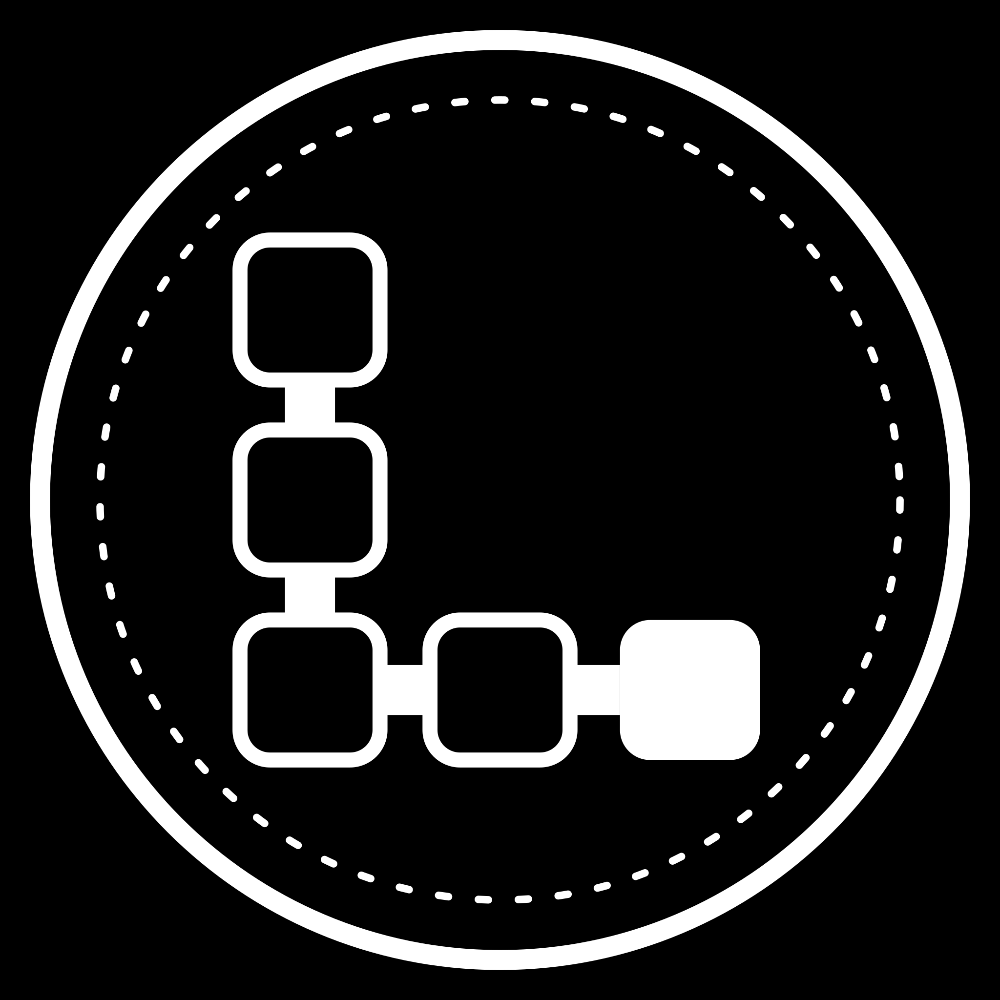

  

<h1 align="center">LA3A Whitepaper</h1>

  
  
  

  <em>Official Document — v1.0 · Author: @LARA · Published: Nov 14, 2026</em>

---

## 01 — Abstract
LA3A is a Solana token built for blockchain gaming, with a hard cap of 100,000 tokens and a launch on September 19, 2030. It rests on one idea: **players should truly own what they play and earn.**

The ecosystem starts in 2029 with the official website and the Extension Game. The token follows one year later, on the project's first anniversary. This paper covers the vision, the technology, the token supply, the roadmap and the people building it.

Every 100 matches played in the game burn one LA3A token, up to a maximum of 25,000 burned in total, so the supply can only fall as the game grows.

## 02 — At a glance

| Parameter | Detail |
| :--- | :--- |
| **Token** | LA3A on Solana |
| **Maximum Supply** | 100,000 LA3A |
| **Burn Rule** | 1 LA3A burned per 100 matches played |
| **Maximum Total Burn** | 25,000 LA3A |
| **Lowest Possible Supply** | 75,000 LA3A |
| **Website & Game** | September 19, 2029 |
| **Token Launch** | September 19, 2030, 00:00 UTC |
| **Official Channel** | Discord |

## 03 — Introduction and vision
LA3A opens a new era of digital ownership for gamers: built for the future and powered by the next generation.

Our vision is a gaming world where the items, progress and value a player creates live on-chain and belong to that player. The token is the foundation, and the Extension Game is where it becomes something people can play.

The brand follows the same idea. Black and white, sharp lines, and a logo made of linked blocks: each block is a step in a chain, and the filled block at the end is the player.

## 04 — The problem
In most games today, players spend time and money on items they do not actually own.
*   **Licensed, not owned.** Items and progress sit inside one publisher's database and can be changed or removed at any time.
*   **No way out.** Value earned in a game usually cannot leave it, so effort cannot be carried to another place.
*   **Slow and costly chains.** Many blockchain games lose players to high fees and long waits for simple actions.
*   **Unfair launches.** Tokens that start with hidden allocations erode community trust before the game exists.

## 05 — The LA3A solution
LA3A answers with two parts that work together: a capped token and a game built around it.
*   **The LA3A token.** A fully decentralized token on Solana with a maximum supply of 100,000.
*   **The Extension Game.** A next-generation Web3 experience powered by LA3A, where players play, earn and truly own, all on-chain. The ecosystem grows beyond a token into an immersive world.

The launch is built on three commitments: **fair distribution**, **locked liquidity** and a **community-first foundation**. The burn ties the two together: every 100 matches played in the Extension Game burn one LA3A, up to 25,000 in total.

## 06 — Technology
LA3A is built on the Solana blockchain, chosen for its speed and very low transaction fees, which a game needs because players act constantly.

**How to buy on launch day:**
1. Create a wallet. Phantom and Solflare both work, in the browser or on mobile.
2. Fund it with SOL, bought from any major exchange.
3. Connect the wallet on the official swap page.
4. Swap SOL for LA3A. The tokens appear in the wallet straight away.

> **Note:** Game mechanics and technical details of the Extension Game will be published as they are finalized.

## 07 — Tokenomics
The supply is strictly capped at 100,000 LA3A tokens, which keeps the token scarce for the long term.

| Parameter | Detail |
| :--- | :--- |
| **Token** | LA3A |
| **Network** | Solana |
| **Maximum Supply** | 100,000 LA3A |
| **Burn Rule** | 1 LA3A burned for every 100 matches played |
| **Maximum Total Burn** | 25,000 LA3A |
| **Lowest Possible Supply** | 75,000 LA3A |
| **Token Launch** | September 19, 2030, 00:00 UTC |

**Distribution:** Fair distribution, with locked liquidity.

> **Allocation breakdown:** To be announced before launch. The full allocation breakdown and the liquidity lock details will be published on the official website and in the official Discord before the launch.

## 08 — Burn Mechanism
Every 100 matches played in the game burn one LA3A token, and the burning stops once 25,000 tokens have been burned in total. Burned tokens leave circulation for good. The supply can only go down, and only as fast as people actually play.

At one token per 100 matches, the 25,000 cap is reached after 2,500,000 matches. Past that point the burn stops and the supply stays fixed.

| Rule | Value |
| :--- | :--- |
| **Trigger** | Every 100 matches played in the game |
| **Burn per trigger** | 1 LA3A |
| **Maximum total burn** | 25,000 LA3A |
| **Matches needed to reach the cap** | 2,500,000 |
| **Supply after the maximum burn** | 75,000 LA3A (25% below max supply) |

> Where the burned tokens come from, and how matches are counted and verified on-chain, will be published with the technical details of the Extension Game.

## 09 — Roadmap
The website and the Extension Game arrive on **September 19, 2029**, and the token launches exactly one year later on **September 19, 2030**, the project's first anniversary.

*   [ ] **Phase 1: Foundation (2029)** - Website & Game Release
*   [ ] **Phase 2: Evolution (2030)** - Token Launch & Liquidity Lock
*   [ ] **Phase 3: Deflation (Ongoing)** - Burn Mechanism Active
*   [ ] **Phase 4: Future (TBA)** - CEX Listings & Expansions

More milestones will be announced as they are confirmed.

## 10 — Community and security
Discord is the only official LA3A channel for now. More channels will be added once they exist.
*   The official contract address will be published on the website and pinned in the Discord server exactly at launch.
*   Do not trust a contract address from any other source, including direct messages and social media accounts.
*   Never share your wallet's seed phrase or private key with anyone, for any reason.

## 11 — FAQ

<strong>When does LA3A launch?</strong>

The website and the Extension Game arrive on September 19, 2029. The token launches on September 19, 2030 at 00:00 UTC.

<strong>Which blockchain is it on?</strong>

Solana.

<strong>What is the maximum supply?</strong>

100,000 LA3A, strictly capped.

<strong>How does the burn work?</strong>

Every 100 matches played in the game burn 1 LA3A, up to 25,000 in total. After that the burning stops.

<strong>How low can the supply go?</strong>

To 75,000 LA3A, if the full 25,000 burn happens.

<strong>Where is the official contract address?</strong>

On the website and pinned in the Discord server at launch. Trust no other source.

## 12 — Glossary

| Term | Meaning |
| :--- | :--- |
| **Token burn** | Sending tokens to a place where they can never be used again, so they leave the supply for good. |
| **Maximum supply** | The most tokens that will ever exist. For LA3A it is 100,000. |
| **Solana** | The blockchain LA3A runs on, known for speed and very low fees. |
| **Wallet** | An app such as Phantom or Solflare that holds your tokens and signs your transactions. |
| **Liquidity lock** | A lock on the funds that let people swap the token, so they cannot be pulled out suddenly. |
| **Seed phrase** | The secret words that give full access to a wallet. Never share them. |
| **Contract address** | The unique address of the token on the blockchain, used to check you hold the real one. |

## 13 — Risks and disclaimer
LA3A is a speculative digital asset, and buying cryptocurrency carries a high level of risk, including the loss of everything you put in.

This paper is not investment, financial or trading advice. Do your own research and speak to a licensed financial advisor before making any investment decision.

Dates, allocations and features in this paper describe current plans and may change. Plans for the Extension Game and the token launch are not promises of delivery or of any return.

---

### 🌐 Connect with us

  
  
  

  

